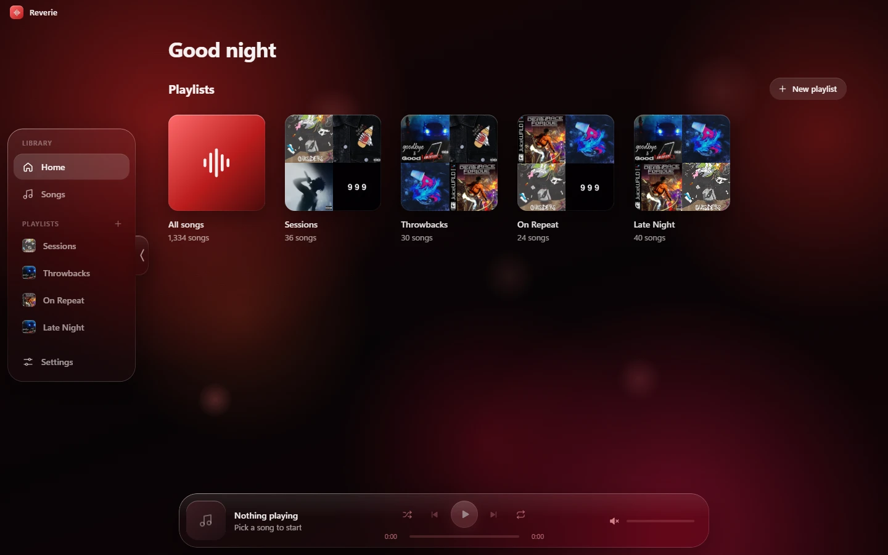
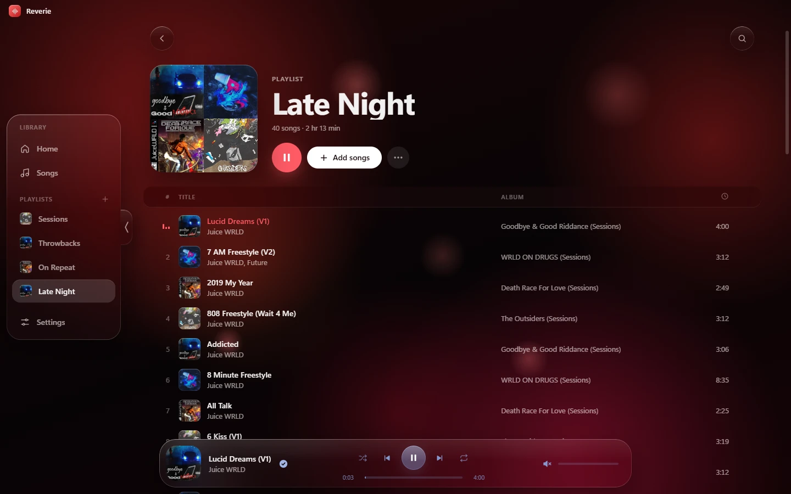
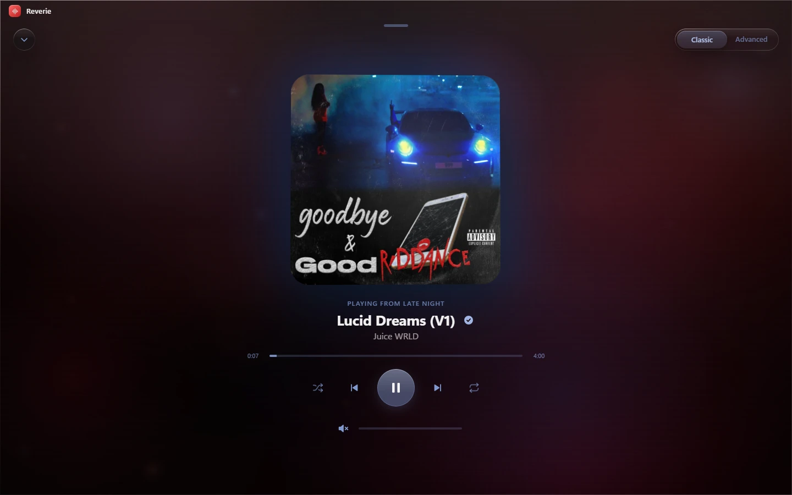
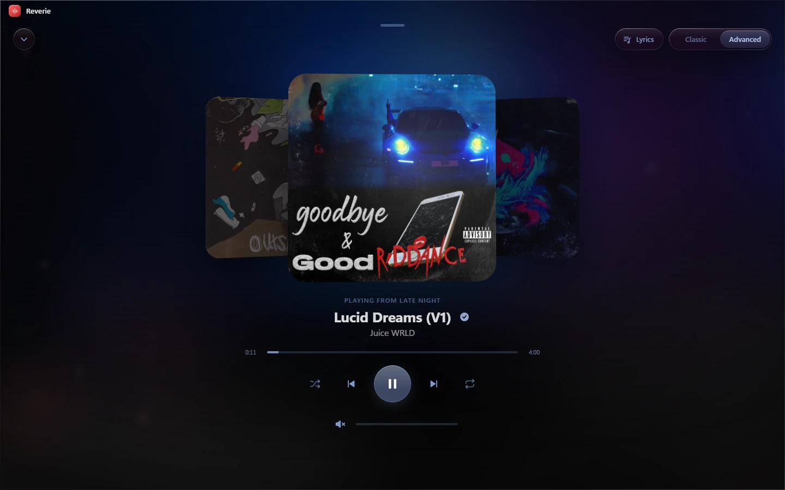
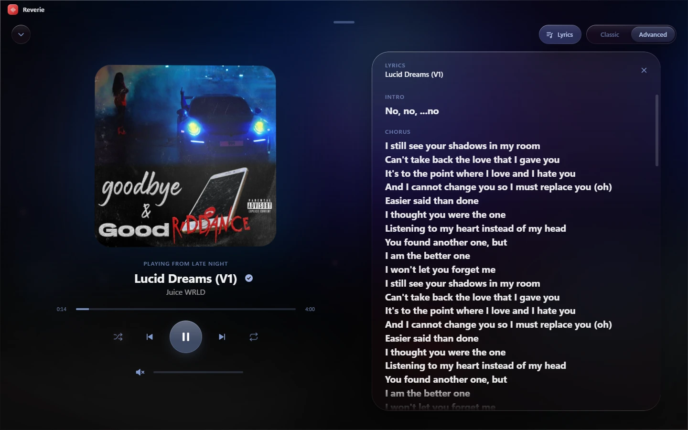

# Reverie

A desktop music player for the music files you already have. Point it at your folders, and Reverie picks up titles, artists, covers and lyrics from the files themselves, lets you build your own playlists and plays everything in a dark red, liquid-glass interface.

No account, no streaming, no internet connection. Everything stays on your computer.



## Screenshots

| Playlist | Full-screen player |
| --- | --- |
|  |  |

| Advanced mode | Lyrics |
| --- | --- |
|  |  |

## Features

**Library**

- Add one or more music folders; subfolders are included
- Titles, artists, albums, covers and embedded lyrics are read from the files' tags
- Fast rescans: unchanged files are taken from a local cache
- Search across songs, artists and albums
- Supported formats: MP3, FLAC, M4A, AAC, OGG, Opus, WAV

**Playlists**

- Create, rename and delete playlists from the Home screen or the sidebar
- Newly added songs go to the top
- Drag songs to reorder them
- Use your own image as a playlist cover, or let Reverie build one from the songs' covers
- Add the playing song to a playlist straight from the player

**Player**

- Shuffle, repeat one or all, seeking and a logarithmic volume control
- A full-screen player that opens from the bottom bar and closes with a swipe down
- Classic mode: the cover tilts towards the pointer, glows in its own colors and moves with the bass, while soft lights react to the music
- Advanced mode: the blurred cover fills the screen, the previous and next songs sit beside it as a stack of cards, and you can drag or swipe the cover to change songs
- Lyrics in a glass panel next to the cover
- Player controls take on the colors of the current cover
- Poster mode: after a few seconds without input only the cover and the title stay on screen

**Windows integration**

- Media keys and the Windows media flyout, with cover art
- Previous, play/pause and next buttons in the taskbar thumbnail
- The window title shows the current song

## Download

Get the installer from the [Releases](../../releases) page and run it.

The installer is not code-signed, so Windows SmartScreen may show "Windows protected your PC". Click **More info** and then **Run anyway**.

Requires 64-bit Windows 10 or 11.

## Build from source

You need [Node.js](https://nodejs.org/) 22 or newer.

```bash
npm install
npm run dev
```

Build the Windows installer:

```bash
npm run build:win
```

The installer ends up in `dist/`.

Other scripts:

| Command | What it does |
| --- | --- |
| `npm run typecheck` | Type-checks the main, preload and renderer code |
| `npm run lint` | Runs ESLint |
| `npm run format` | Formats the code with Prettier |

## Where your data lives

Reverie never changes your music files. Its own data is stored in `%APPDATA%\reverie`:

- `settings.json`: the connected folders
- `library.json` and `covers/`: the library cache, which can always be rebuilt
- `playlists.json` and `playlist-covers/`: your playlists

## Tech stack

[Electron](https://www.electronjs.org/), [React](https://react.dev/) and TypeScript, built with [electron-vite](https://electron-vite.org/) and packaged with [electron-builder](https://www.electron.build/). Tags are read with [music-metadata](https://github.com/borewit/music-metadata).

## Author

Made by [olistrife](https://github.com/OliStrife).
